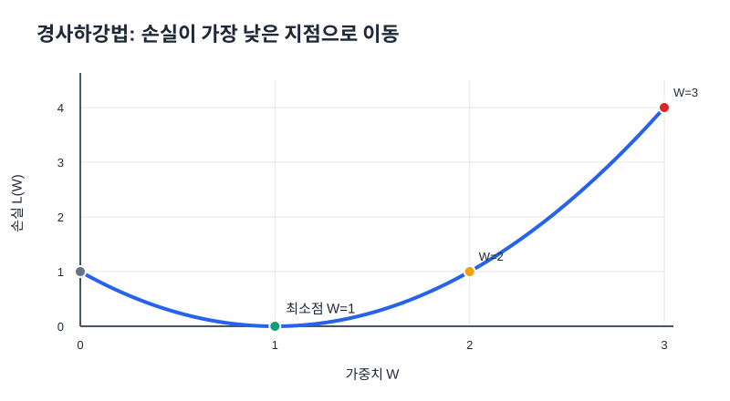
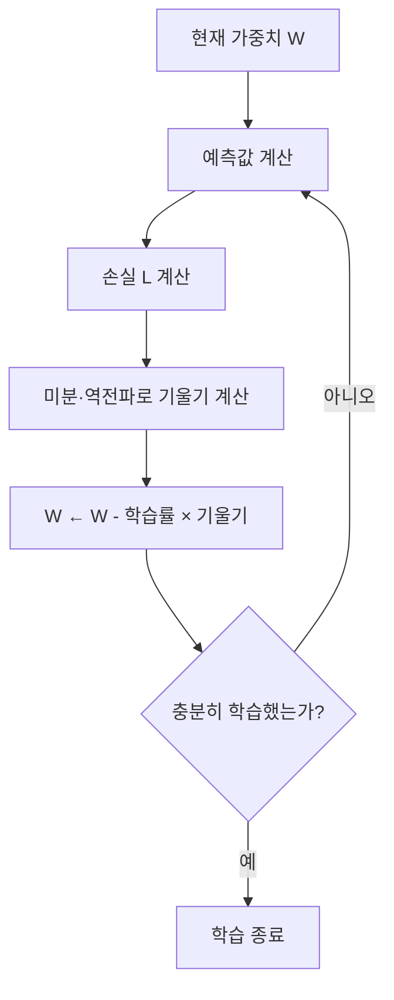

# 01. 경사하강법 (Gradient Descent)

## 한 문장으로

**경사하강법은 손실 함수의 기울기를 이용해 가중치와 편향을 손실이 작아지는 방향으로 조금씩 업데이트하는 방법**이다.

## 1. 가장 작은 회귀 예제로 이해하기

입력값이 `x = 1`, 정답이 `t = 1`인 상황을 생각한다. 모델은 입력에 가중치 `W`를 곱해서 예측한다.

$$\hat y = Wx$$

손실을 예측값과 정답 차이의 제곱으로 정의하면 다음과 같다.

$$L = (t-\hat y)^2 = (1-W)^2$$

| 가중치 `W` | 예측값 `ŷ = W × 1` | 손실 `L = (1-W)²` | 해석 |
|---:|---:|---:|---|
| 0 | 0 | 1 | 정답 1과 차이가 있다 |
| 0.5 | 0.5 | 0.25 | 정답에 가까워졌다 |
| 1 | 1 | 0 | 예측과 정답이 같다 |
| 2 | 2 | 1 | 정답보다 크게 예측한다 |
| 3 | 3 | 4 | 오차가 커졌다 |

그래프의 가로축은 가중치 `W`, 세로축은 손실 `L`이다. 이 예제에서 손실은 `W = 1`일 때 가장 작다. 학습은 현재 위치에서 기울기를 살펴 이 최소점에 가까워지는 과정이다.

## 2. 미분으로 이동 방향 정하기

$$L(W) = (1-W)^2$$

`W`에 대해 미분한다.

$$\frac{dL}{dW} = 2(1-W)(-1) = 2(W-1)$$

| 현재 위치 | 기울기 `dL/dW` | 기울기의 의미 | 손실을 줄이려면 |
|---|---:|---|---|
| `W < 1` | 음수 | W가 증가하는 쪽으로 가면 손실이 줄어드는 구간 | W를 키우는 방향 |
| `W = 1` | 0 | 최소점에서 순간 기울기가 0 | 이상적인 최소점에 도달 |
| `W > 1` | 양수 | W가 증가하는 쪽으로 가면 손실이 커지는 구간 | W를 줄이는 방향 |

기울기는 **현재 위치 주변에서 손실이 어느 방향으로 변하는지** 알려준다. 그래서 기울기의 반대 방향으로 이동한다.

## 3. 가중치 업데이트 공식

$$W_{new} = W_{old} - \eta\frac{dL}{dW}$$

- `W_old`: 업데이트하기 전 가중치
- `W_new`: 업데이트한 뒤 가중치
- `η`(에타): 학습률(learning rate), 한 번에 이동할 크기
- `dL/dW`: 가중치에 대한 손실의 기울기

### 숫자를 넣어 한 번 업데이트하기

현재 `W = 3`, 학습률 `η = 0.1`이라면 기울기는 `2(3-1) = 4`이다.

$$W_{new} = 3 - 0.1\times4 = 2.6$$

업데이트 전 손실은 `(1-3)² = 4`, 업데이트 후 손실은 `(1-2.6)² = 2.56`이다. 이번 업데이트로 손실이 줄었다.

| 단계 | 업데이트 전 W | 기울기 | 업데이트 후 W | 업데이트 후 손실 |
|---:|---:|---:|---:|---:|
| 시작 | 3.000 | 4.000 | — | 4.000 |
| 1 | 3.000 | 4.000 | 2.600 | 2.560 |
| 2 | 2.600 | 3.200 | 2.280 | 1.638 |
| 3 | 2.280 | 2.560 | 2.024 | 1.049 |

이 표에서는 최소점 `W = 1`에 점점 가까워지며 손실이 낮아진다. 실제 신경망에서는 가중치가 매우 많고 손실 함수도 복잡해 계산을 반복한다.

## 4. 학습률이 중요한 이유

| 학습률 | 장점 | 너무 크거나 작을 때의 문제 |
|---|---|---|
| 너무 작음 | 업데이트가 세밀함 | 최소점 근처까지 가는 데 많은 반복이 필요 |
| 적절함 | 손실을 안정적으로 줄일 수 있음 | 데이터와 모델에 따라 실험이 필요 |
| 너무 큼 | 한 번에 멀리 움직임 | 최소점을 건너뛰거나 손실이 오히려 커질 수 있음 |

학습률은 무조건 클수록 좋은 값이 아니다. 손실이 감소하는지 확인하면서 조절해야 한다.

## 5. 전체 학습 과정

여러 가중치를 한꺼번에 다룰 때는 기울기를 벡터로 모아 다음처럼 쓴다.

$$\mathbf{W}_{new}=\mathbf{W}_{old}-\eta\nabla_{\mathbf W}L$$

`∇L`(나블라 L)은 각 가중치에 대한 편미분을 모은 기울기다.

## 자주 헷갈리는 점

- **미분은 가중치를 바꾸는 행위가 아니다.** 미분은 어느 방향으로 얼마나 손실이 변하는지를 계산한다.
- **역전파는 기울기를 계산한다.** 실제 매개변수 업데이트는 경사하강법이나 옵티마이저가 한다.
- **손실 0은 모든 문제에서 반드시 달성해야 하는 값이 아니다.** 보지 못한 데이터에서도 성능이 좋은지가 더 중요하다.

## 자기 점검

1. `W = 2`, `x = 1`, `t = 1`일 때 예측값과 손실은 얼마인가?
2. 이 예제에서 `dL/dW = 2(W-1)`이다. `W = 0.5`일 때 기울기는 얼마이며, W를 어느 방향으로 바꾸어야 하는가?
3. 학습률이 지나치게 크면 어떤 일이 생길 수 있는가?
4. 역전파와 가중치 업데이트의 차이를 한 문장으로 설명하라.
