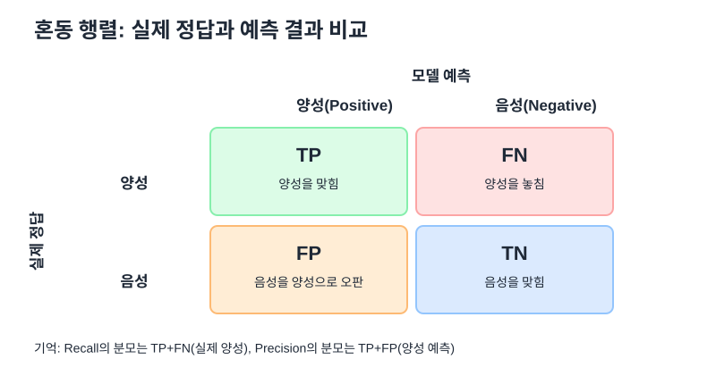
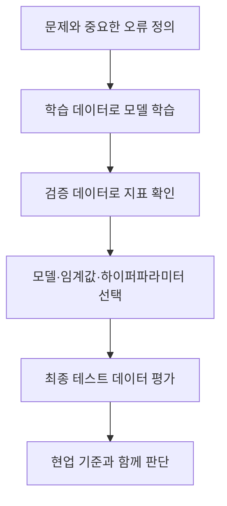

# 02. 모델 검증 및 평가

## 1. 혼동 행렬 (Confusion Matrix)

혼동 행렬은 **실제 정답과 모델 예측을 교차해서 세어 보는 표**다. 분류 성능 지표를 계산하는 출발점이다.

| 기호 | 실제 정답 | 모델 예측 | 뜻 |
|---|---|---|---|
| TP | 양성(Positive) | 양성 | 양성을 맞힘 |
| FN | 양성 | 음성(Negative) | 실제 양성을 놓침 |
| FP | 음성 | 양성 | 음성을 양성이라고 잘못 알림 |
| TN | 음성 | 음성 | 음성을 맞힘 |

암 검사 예시에서 양성은 `암`, 음성은 `정상`이라고 정하면 TP는 암 환자를 암으로 예측한 경우, FN은 암 환자를 정상으로 예측한 경우다.

## 2. 하나의 예제로 지표를 모두 계산하기

검사 대상 100명에 대해 다음 결과를 얻었다고 하자.

| 실제 / 예측 | 암이라고 예측 | 정상이라고 예측 | 실제 합계 |
|---|---:|---:|---:|
| 실제 암 | TP = 8 | FN = 2 | 10 |
| 실제 정상 | FP = 3 | TN = 87 | 90 |
| 예측 합계 | 11 | 89 | 100 |

### 정확도 (Accuracy)

**전체 중 몇 명을 맞혔는가?**

$$Accuracy=\frac{TP+TN}{TP+TN+FP+FN}$$

$$Accuracy=\frac{8+87}{100}=0.95=95\%$$

### 재현율 (Recall)

**실제 양성 중에서 몇 명을 찾아냈는가?**

$$Recall=\frac{TP}{TP+FN}=\frac{8}{8+2}=80\%$$

재현율은 실제 양성 10명을 기준으로 계산한다. FN이 많아지면 재현율은 낮아진다.

### 정밀도 (Precision)

**양성이라고 예측한 결과 중에서 실제 양성은 몇 개인가?**

$$Precision=\frac{TP}{TP+FP}=\frac{8}{8+3}\approx72.73\%$$

정밀도는 양성이라고 예측한 11명을 기준으로 계산한다. FP가 많아지면 정밀도는 낮아진다.

### F1-Score

정밀도와 재현율의 조화평균이다. 두 지표가 균형 있게 높은지 하나의 값으로 요약한다.

$$F1=2\times\frac{Precision\times Recall}{Precision+Recall}$$

위 예제에서는 `2 × 0.7273 × 0.8 ÷ (0.7273 + 0.8) ≈ 0.7619`, 즉 **약 76.19%**다.

## 3. 네 가지 지표 비교

| 지표 | 분모로 삼는 대상 | 잘못된 예측 중 특히 민감한 항목 | 핵심 질문 |
|---|---|---|---|
| Accuracy | 전체 표본 | FP와 FN 모두 | 전체적으로 몇 %를 맞혔나? |
| Recall | 실제 양성(TP + FN) | FN | 양성을 얼마나 놓치지 않았나? |
| Precision | 양성 예측(TP + FP) | FP | 양성이라고 한 결과가 얼마나 믿을 만한가? |
| F1-Score | Precision과 Recall을 함께 사용 | FN과 FP의 균형 | 정밀도와 재현율이 함께 높은가? |

## 4. 정확도가 함정이 되는 경우

실제 암 환자가 5명이고 정상인이 95명인 100명 데이터를 생각하자. 모델이 모두 정상이라고만 예측하면 95명을 맞히므로 정확도는 95%다. 하지만 암 환자 5명을 모두 놓쳐 재현율은 0%다.

| 실제 상황 | 결과 |
|---|---:|
| 정상인 95명을 정상으로 예측 | 95명 정답 |
| 암 환자 5명도 정상으로 예측 | 5명 오답 |
| 정확도 | 95% |
| 재현율 | 0% |

따라서 클래스 비율이 크게 불균형하면 정확도 하나만으로 모델을 평가하면 안 된다. 어떤 오류가 더 위험한지 먼저 결정하고 지표를 선택한다.

## 실전 확장 1. 임계값에 따른 정밀도·재현율

이진 분류 모델은 보통 양성일 확률을 출력하고, 기준값(threshold)과 비교해 최종 클래스를 정한다. 예를 들어 기준값이 `0.5`라면 확률 0.7은 양성으로 분류한다.

- 기준값을 낮추면 양성으로 판정하는 표본이 늘어 보통 재현율은 올라가지만 FP가 늘어 정밀도가 낮아질 수 있다.
- 기준값을 높이면 양성 판정이 까다로워져 보통 정밀도는 올라갈 수 있지만 실제 양성을 놓칠 수 있다.
- 이것은 경향이지 모든 데이터에서 보장되는 법칙은 아니다. 실제 검증 데이터로 확인해야 한다.

## 6. F1-Score의 의미

산술평균은 정밀도 100%, 재현율 0%를 50%로 계산한다. 하지만 이 경우 양성 데이터를 전혀 찾지 못했으므로 좋은 균형이라고 보기 어렵다. F1은 조화평균을 사용한다.

$$F1=\frac{2PR}{P+R}$$

`P = 1`, `R = 0`이면 F1은 0이다. 다만 F1은 TN을 직접 반영하지 않으므로, 전체적인 음성 분류 성능이 중요하다면 다른 지표도 함께 본다.

## 7. 특성 중요도 (Feature Importance)

특성 중요도는 모델의 예측에 어떤 입력 변수가 중요하게 사용됐는지 파악하는 단서다. 중요도가 높다는 것만으로 그 변수가 결과의 원인이라고 결론 내릴 수는 없다.

| 방법 | 어떻게 계산하는가? | 해석 시 주의점 |
|---|---|---|
| 내장 특성 중요도 | 학습 중 노드 분할이나 불순도 감소 등에 기반해 계산 | 모델 종류와 계산 방식에 영향을 받음 |
| 순열 특성 중요도 | 평가 데이터의 한 특성을 섞고 성능이 얼마나 떨어지는지 측정 | 서로 강하게 상관된 특성이 있으면 중요도가 나뉘어 보일 수 있음 |

학습용 데이터에서만 높은 중요도를 보이고 검증 데이터에서는 영향이 사라진다면 과적합이나 데이터 특이성 여부를 확인한다. 특성 중요도 비교는 과적합을 의심할 단서이지, 그것만으로 과적합을 확정하는 검사는 아니다.

## 8. 회귀 평가: MSE와 RMSE

분류는 범주를 맞히지만, 회귀는 가격·온도처럼 연속적인 숫자를 예측한다. 회귀에서는 예측값과 실제값 사이의 오차 크기를 평가한다.

$$MSE=\frac{1}{n}\sum_{i=1}^{n}(y_i-\hat y_i)^2$$

$$RMSE=\sqrt{MSE}$$

예를 들어 실제값이 `[3, 5, 7]`, 예측값이 `[2, 5, 9]`라면 오차는 `[-1, 0, 2]`, 제곱 오차는 `[1, 0, 4]`다.

$$MSE=\frac{1+0+4}{3}=1.667$$

$$RMSE=\sqrt{1.667}\approx1.291$$

RMSE가 작을수록 예측 오차가 작다는 뜻이다. RMSE는 제곱근을 취하므로 원래 예측 대상과 같은 단위를 갖는다. 단, 이상치가 있으면 큰 오차에 강하게 영향을 받는다.

## 실전 확장 2. 모델 평가 순서

- 학습 데이터: 모델 매개변수를 학습하는 데 사용
- 검증 데이터: 후보 모델, 설정값, 임계값을 선택하는 데 사용
- 테스트 데이터: 최종 선택 후 일반화 성능을 평가하는 데 사용

테스트 데이터를 여러 번 살펴 모델을 계속 고르면 테스트 데이터에 간접적으로 맞춰질 수 있다. 가능하면 최종 평가 전까지 테스트 데이터는 따로 보관한다.

## 자기 점검

1. TP=8, FN=2, FP=3, TN=87일 때 Accuracy, Recall, Precision을 각각 계산하라.
2. Recall과 Precision의 분모가 왜 다른지 설명하라.
3. 암 환자가 5%인 데이터에서 전부 정상이라고 예측하면 정확도와 재현율은 각각 어떻게 되는가?
4. F1-Score가 Precision과 Recall의 산술평균과 다른 이유는?
5. 내장 특성 중요도와 순열 특성 중요도의 차이는?
6. 실제값 `[3, 5, 7]`, 예측값 `[2, 5, 9]`에서 MSE와 RMSE를 계산하라.
