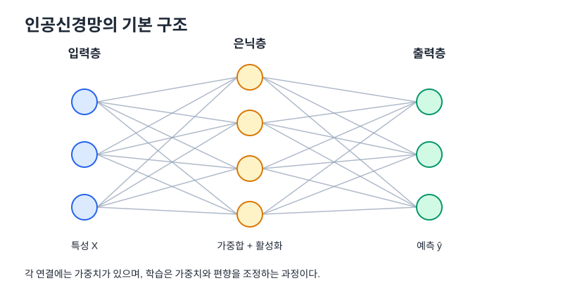
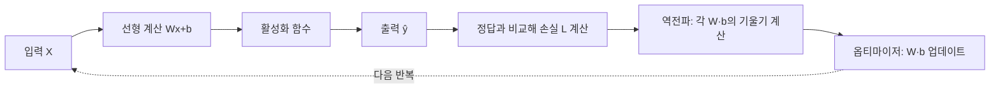

# 03. 딥러닝 (Deep Learning)

## 1. 큰 그림

딥러닝은 여러 층의 인공신경망을 통해 입력 데이터에서 유용한 표현을 학습하는 방법이다. 핵심은 복잡한 구조 자체보다 **예측 → 손실 계산 → 기울기 계산 → 매개변수 업데이트**의 반복이다.



| 층 | 역할 | 예시 |
|---|---|---|
| 입력층(Input) | 모델에 넣을 특성을 받음 | 나이, 월 요금, 가입 기간 |
| 은닉층(Hidden) | 가중합과 활성화 함수로 표현을 변환 | 변수들 사이의 복잡한 패턴 학습 |
| 출력층(Output) | 문제의 유형에 맞는 최종 결과 생성 | 이탈 확률, 클래스 점수, 집값 |

## 2. 퍼셉트론: 인공 뉴런 하나

퍼셉트론은 여러 입력에 가중치를 곱하고, 모두 더한 다음 편향을 더한다.

$$z=w_1x_1+w_2x_2+\cdots+w_nx_n+b$$

- `x`: 입력 신호(특성)
- `w`: 가중치. 해당 입력 신호의 영향력을 조절
- `b`: 편향. 입력이 0이어도 출력의 기준점을 이동시킬 수 있음
- `z`: 가중합, 활성화 함수에 들어가는 값

### 계산 예제

`x₁=2`, `x₂=1`, `w₁=0.5`, `w₂=-1`, `b=0.2`라면

$$z=0.5\times2+(-1)\times1+0.2=0.2$$

ReLU를 적용하면 `max(0, 0.2) = 0.2`가 된다. 입력이 같아도 가중치와 편향을 어떻게 설정했는지에 따라 출력은 달라진다.

## 3. 활성화 함수

활성화 함수는 가중합을 다음 층으로 전달할 값으로 바꾼다. 비선형 활성화 함수가 없으면 여러 선형 층을 쌓더라도 하나의 선형 변환으로 합쳐질 수 있어 복잡한 비선형 관계를 학습하기 어렵다.

| 함수 | 수식 또는 동작 | 출력 범위 | 대표적인 사용 |
|---|---|---|---|
| 항등(Identity) | `f(x)=x` | 실수 전체 | 회귀 출력층 |
| 계단(Step) | 임계값을 기준으로 0 또는 1 | 0 또는 1 | 개념 이해, 전통적 퍼셉트론 |
| 시그모이드(Sigmoid) | `1/(1+e⁻ˣ)` | 0~1 | 이진 분류 확률 출력 |
| ReLU | `max(0,x)` | 0 이상 | 은닉층에서 널리 사용 |
| 소프트맥스(Softmax) | 지수화한 점수를 합으로 나눔 | 각 값 0~1, 합계 1 | 단일 정답 다중 분류 |

시그모이드는 포화 영역에서 기울기가 매우 작아질 수 있다. ReLU는 양수 구간에서 기울기 전달이 단순하다. 함수 선택은 문제와 모델 설계에 맞춰야 한다.

## 4. 출력층은 문제 유형에 맞춘다

| 문제 | 출력 뉴런 | 최종 해석 | 일반적인 손실 함수 |
|---|---:|---|---|
| 회귀 | 예측하려는 수치 수에 맞춤(보통 1개) | 가격, 수량, 온도 등 숫자 | MSE 등 |
| 이진 분류 | 보통 1개 로짓 | 양성일 확률 | BCE 또는 `BCEWithLogitsLoss` |
| 다중 클래스 분류 | 클래스 개수만큼 | 클래스별 점수/확률 | Cross-Entropy |

PyTorch의 `CrossEntropyLoss`는 내부에서 로그-소프트맥스와 손실 계산을 처리하므로 일반적으로 모델 출력에 Softmax를 미리 적용하지 않고 **raw logits**를 전달한다.

## 5. 손실 함수: 예측이 얼마나 틀렸는가?

손실 함수는 예측과 정답 사이의 오차를 숫자 하나로 요약한다. 학습의 목표는 학습 데이터의 손실을 낮추는 매개변수를 찾는 것이다. 다만 학습 손실만 낮고 새로운 데이터의 성능이 나쁘면 과적합일 수 있다.

### 회귀: 평균 제곱 오차(MSE)

$$MSE=\frac{1}{n}\sum_{i=1}^{n}(y_i-\hat y_i)^2$$

오차를 제곱해 부호를 없애고, 큰 오차에 더 큰 페널티를 준다.

### 분류: 교차 엔트로피(Cross-Entropy)

다중 분류의 개념식은 다음과 같다.

$$L=-\sum_k t_k\log(p_k)$$

여기서 `tₖ`는 정답 레이블, `pₖ`는 클래스 k에 대한 예측 확률이다. 원-핫 레이블에서는 정답 위치만 1이므로 정답 클래스의 확률이 손실을 좌우한다. 자세한 계산은 [다중 분류 손실](06_다중분류_손실.md)을 참고한다.

## 6. 순전파와 역전파



- **순전파(Forward Pass):** 입력에서 출력까지 계산하고 손실을 구한다.
- **역전파(Backpropagation):** 연쇄법칙을 이용해 손실이 각 가중치와 편향에 얼마나 민감한지 계산한다.
- **옵티마이저(Optimizer):** 계산된 기울기를 사용해 매개변수를 실제로 업데이트한다.

역전파가 가중치를 직접 고치는 것은 아니다. 역전파는 기울기를 계산하고, 옵티마이저가 업데이트 규칙을 적용한다.

## 7. 미분과 연쇄법칙

손실이 여러 계산 단계를 거쳐 만들어질 때 각 단계의 미분을 곱해 전체 미분을 계산한다.

$$\frac{\partial L}{\partial w}=\frac{\partial L}{\partial a}\times\frac{\partial a}{\partial z}\times\frac{\partial z}{\partial w}$$

- `L`: 손실
- `z`: 가중합
- `a`: 활성화 함수를 통과한 값
- `w`: 학습 대상 가중치

이 원리를 각 층의 매개변수에 적용하는 것이 신경망 역전파의 핵심이다. 미분의 기초는 [미분](07_미분.md), 업데이트 규칙은 [경사하강법](01_경사하강법.md)을 참고한다.

## 8. 배치와 학습률

| 용어 | 뜻 | 기억할 점 |
|---|---|---|
| Epoch | 학습 데이터 전체를 한 번 훑는 것 | 전체 데이터를 여러 epoch 동안 반복 학습 가능 |
| Batch | 한 번의 업데이트에 사용하는 데이터 묶음 | 메모리 사용량과 업데이트 빈도에 영향 |
| Mini-batch | 학습 데이터를 작은 batch로 나눈 방식 | 딥러닝에서 흔히 사용 |
| Learning rate | 업데이트 보폭 | 너무 크면 불안정, 너무 작으면 학습이 느릴 수 있음 |

데이터가 `N`개이고 미니배치 크기가 `B`라면 한 epoch의 업데이트 횟수는 보통 `ceil(N/B)`회다(마지막 작은 배치를 버리지 않는 경우).

## 9. 대표 최적화 알고리즘

| 알고리즘 | 직관 | 주의할 점 |
|---|---|---|
| SGD | 현재 기울기 반대쪽으로 이동 | 업데이트가 흔들릴 수 있음 |
| Momentum | 이전 업데이트 방향을 일부 기억 | 모멘텀 계수 등의 설정 필요 |
| AdaGrad | 누적 기울기를 이용해 매개변수별 보폭 조절 | 누적량이 계속 커지면서 학습률이 지나치게 작아질 수 있음 |
| Adam | 모멘텀과 적응형 학습률 아이디어를 결합 | 기본값이 항상 최선인 것은 아님 |

## 실전 확장: PyTorch 미니 예제 — 다중 분류

아래 예시는 입력 특성 4개로 3개 클래스 중 하나를 분류하는 형태다.

```python
import torch
from torch import nn

model = nn.Sequential(
    nn.Linear(4, 16),
    nn.ReLU(),
    nn.Linear(16, 8),
    nn.ReLU(),
    nn.Linear(8, 3),  # 클래스 3개 → 출력 로짓 3개
)

criterion = nn.CrossEntropyLoss()
optimizer = torch.optim.Adam(model.parameters(), lr=0.001)

# X: (batch_size, 4), y: (batch_size,) 정수 클래스 인덱스
# logits에는 Softmax를 미리 적용하지 않는다.
logits = model(X)
loss = criterion(logits, y.long())

optimizer.zero_grad()  # 이전 기울기 초기화
loss.backward()        # 역전파로 기울기 계산
optimizer.step()       # 가중치 업데이트
```

이 코드는 한 번의 학습 업데이트를 보여준다. 실제 학습에서는 데이터를 여러 batch로 반복하고, 검증 데이터로 성능을 확인한다. `X`와 `y`는 코드 실행 전에 올바른 크기와 자료형으로 준비해야 한다.

### 선형층의 매개변수 수

`nn.Linear(in_features, out_features)`의 가중치는 `in_features × out_features`, 편향은 `out_features`개다.

예를 들어 `nn.Linear(4, 16)`은 `4 × 16 + 16 = 80`개의 학습 매개변수를 가진다.

## 실전 확장: 과적합을 조심하기

- **과소적합(Underfitting):** 모델이 너무 단순하거나 충분히 학습되지 않아 학습 데이터도 잘 설명하지 못한다.
- **과적합(Overfitting):** 학습 데이터에 지나치게 맞춰져 학습 성능은 좋은데 새로운 데이터 성능은 떨어진다.
- 학습 데이터와 검증 데이터 성능을 함께 보고, 모델 복잡도·데이터·규제·학습 횟수 등을 점검한다.

## 자기 점검

1. 퍼셉트론에서 가중치와 편향은 각각 무슨 역할을 하는가?
2. 회귀·이진 분류·다중 분류의 출력층과 손실 함수를 비교하라.
3. 역전파가 계산하는 것은 예측값인가, 기울기인가?
4. `nn.Linear(4, 16)`의 학습 매개변수는 몇 개인가?
5. 다중 분류에서 `CrossEntropyLoss`에 Softmax를 미리 적용하지 않는 이유는?
6. 과적합을 확인하려면 학습 성능 외에 무엇을 봐야 하는가?
