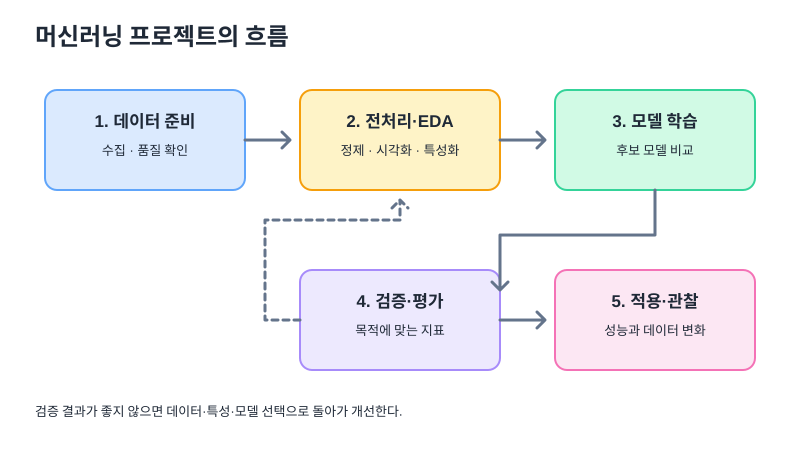
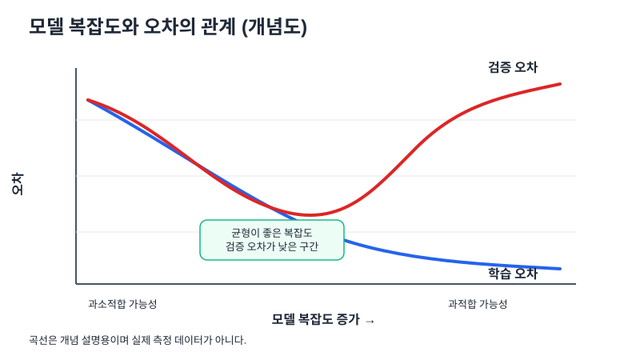

# 05. 머신러닝 기본 개념과 모델 선택

## 1. 데이터 분석부터 모델 평가까지



| 단계 | 핵심 질문 | 주요 작업 |
|---|---|---|
| 문제 정의 | 무엇을 예측하거나 발견할 것인가? | 목표 변수·성공 기준 정의 |
| 데이터 수집 | 필요한 데이터가 있는가? | 원천 확인, 데이터 결합 |
| 전처리 | 모델이 사용할 수 있는 형태인가? | 결측치·중복·형식·이상치 확인 |
| 탐색적 분석(EDA) | 데이터에 어떤 패턴이 있는가? | 요약 통계, 그래프, 상관관계 확인 |
| 특성 공학 | 예측에 유용한 변수가 무엇인가? | 파생 변수, 인코딩, 스케일링 |
| 모델 학습 | 어떤 규칙을 학습할 것인가? | 후보 모델 학습 |
| 검증·평가 | 새로운 데이터에서도 잘 맞는가? | 지표 비교, 교차 검증, 오류 분석 |
| 적용·모니터링 | 실제 환경에서도 유지되는가? | 배포, 성능·데이터 변화 감시 |

## 2. 지도 학습과 비지도 학습

| 구분 | 정답 레이블 | 대표 목표 | 예시 |
|---|---|---|---|
| 지도 학습(Supervised) | 있음 | 입력에서 정답을 예측 | 이탈 여부, 집값, 합격 여부 |
| 비지도 학습(Unsupervised) | 없음 | 데이터 구조·그룹 발견 | 고객 군집, 패턴 탐색 |

### 분류와 회귀 구분

- **분류(Classification):** 결과가 범주다. 예: 이탈/유지, 스팸/정상, 고양이/강아지.
- **회귀(Regression):** 결과가 연속적인 숫자다. 예: 가격, 수요량, 기온.

문제를 정할 때는 `y`가 범주인지 숫자인지를 먼저 본다. 모델 이름보다 예측 목표가 우선이다.

## 실전 확장 1. 데이터 분할: 학습과 평가를 분리한다

예시로 데이터 1,000개를 70%/15%/15%로 나눈다면 다음과 같다. 이 비율은 예시이며 유일한 정답은 아니다.

| 데이터 묶음 | 예시 개수 | 용도 |
|---|---:|---|
| 학습(Train) | 700 | 모델 매개변수를 학습 |
| 검증(Validation) | 150 | 후보 모델·하이퍼파라미터 선택 |
| 테스트(Test) | 150 | 최종 선택한 모델의 일반화 성능 평가 |

시간 순서가 중요한 시계열 데이터는 무작위로 섞으면 미래 정보가 과거 학습에 들어갈 수 있으므로 시간 순서에 맞게 나눈다.

## 4. 특성 공학과 전처리

특성 공학(Feature Engineering)은 기존 변수를 바꾸거나 조합해 예측에 더 유용한 입력을 만드는 과정이다. 예를 들어 `월 결제액 / 이용 개월 수`처럼 목적에 맞는 비율 변수를 만들 수 있지만, 분모가 0인 경우와 누수 가능성을 확인해야 한다.

### 인코딩(Encoding)

모델이 사용할 수 있도록 범주형 데이터를 숫자 형태로 표현한다.

| 요일 | One-Hot: 월 | One-Hot: 화 | One-Hot: 수 |
|---|---:|---:|---:|
| 월 | 1 | 0 | 0 |
| 화 | 0 | 1 | 0 |
| 수 | 0 | 0 | 1 |

```python
import pandas as pd

encoded = pd.get_dummies(df, columns=["day"], dtype=int)
```

- **One-Hot Encoding:** 범주마다 별도 컬럼을 만들어 1/0으로 표시한다. 범주 간 순위가 없을 때 유용하다.
- **Label Encoding:** 범주에 정수 코드를 부여한다. 이 정수가 실제 크기나 순위를 의미하지 않는데도 모델이 순서로 해석할 수 있어 사용 방식을 주의한다.

### 스케일링(Scaling)

| 방법 | 아이디어 | 흔한 식 | 결과 해석 |
|---|---|---|---|
| 표준화(Standardization) | 평균을 빼고 표준편차로 나눔 | `z = (x - 평균) / 표준편차` | 평균 0, 표준편차 1에 가까운 분포 |
| 정규화(Normalization, Min-Max) | 최소~최대 범위를 일정 구간으로 조정 | `(x-min)/(max-min)` | 보통 0~1 범위 |

거리나 내적에 민감한 모델은 스케일링의 영향을 받을 수 있다. 트리 기반 모델은 일반적으로 스케일 변화에 덜 민감하다.

**데이터 누수 방지:** 스케일러와 인코더는 학습 데이터에 맞춰 `fit`하고, 검증·테스트에는 같은 변환을 `transform`한다. 전체 데이터로 먼저 `fit`하면 평가 데이터 정보가 학습 과정에 섞일 수 있다.

## 5. 대표 모델 지도

| 모델 | 기본 아이디어 | 장점 | 주의할 점 | 자주 연결되는 문제 |
|---|---|---|---|---|
| 선형 회귀 | 입력의 선형 결합으로 숫자 예측 | 단순하고 계수 해석이 쉬움 | 관계가 비선형이면 한계 | 회귀 |
| 로지스틱 회귀 | 선형 점수를 확률로 변환 | 기준 모델로 유용, 비교적 해석 가능 | 복잡한 비선형 관계에는 한계 | 분류 |
| SVM | 클래스 사이 마진을 크게 하는 경계 탐색 | 커널로 복잡한 경계 표현 가능 | 스케일링과 파라미터 영향, 큰 데이터 비용 | 분류·회귀 변형 |
| 결정 트리 | 조건에 따라 반복 분할 | 규칙을 설명하기 쉬움 | 깊으면 과적합 가능 | 분류·회귀 |
| Random Forest | 여러 트리를 서로 다른 표본/특성으로 학습해 결합 | 단일 트리보다 변동을 줄이는 데 유리 | 모델 해석이 복잡해질 수 있음 | 분류·회귀 |
| Boosting / XGBoost | 이전 단계의 오류를 보완하며 모델을 순차적으로 결합 | 표 형태 데이터에서 강력한 후보 | 파라미터 조정·검증 중요 | 분류·회귀 |
| K-Means | 중심점에 가까운 데이터끼리 묶음 | 기본 군집화 방법으로 단순 | K 선택·스케일·초기 중심에 영향 | 비지도 학습 |
| PCA | 분산을 보존하는 방향으로 차원 축소 | 변수 수를 줄이고 시각화에 도움 | 주성분 해석이 원래 변수보다 어려울 수 있음 | 차원 축소 |

## 6. 규제(Regularization)와 일반화

규제는 모델이 학습 데이터에 지나치게 맞춰지는 것을 억제하는 방법 중 하나다.

- **L1 / Lasso:** 계수의 절댓값 합에 페널티를 줘 일부 계수를 0으로 만들 수 있다.
- **L2 / Ridge:** 계수 제곱합에 페널티를 줘 큰 계수를 줄이는 경향이 있다.

규제가 강하면 모델이 너무 단순해져 과소적합할 수도 있다. 적절한 강도는 검증 데이터로 정한다.

## 7. 과소적합과 과적합



- **과소적합:** 모델이 패턴을 충분히 표현하지 못해 학습·검증 성능이 모두 나쁘다.
- **과적합:** 학습 데이터에 지나치게 맞아 학습 오차는 낮지만 검증 오차는 커진다.
- 목표는 학습 오차만 최소화하는 게 아니라, 보지 못한 데이터에 대해서도 성능을 유지하는 것이다.

## 8. 앙상블(Ensemble)

| 방식 | 결합 방법 | 핵심 아이디어 |
|---|---|---|
| Voting / Averaging | 예측을 투표 또는 평균으로 결합 | 여러 모델의 판단을 합침 |
| Random Forest | 다수의 결정 트리 결합 | 여러 트리의 변동을 줄임 |
| Boosting | 순차적으로 모델을 학습해 오류를 보완 | 이전 단계의 부족함을 다음 단계가 학습 |
| Stacking | 기본 모델의 예측을 메타 모델의 입력으로 사용 | 모델별 장점을 조합 |

앙상블을 사용한다고 반드시 성능이 좋아지는 것은 아니다. 비교 기준을 정하고 검증 데이터에서 단일 모델과 비교한다.

## 9. 차원 축소와 군집화

### PCA

PCA는 데이터의 분산을 잘 설명하는 방향으로 좌표축을 바꿔 특성 수를 줄인다. 2차원으로 줄이면 시각화가 쉬울 수 있지만, 일부 정보는 손실된다. PCA 전 스케일링 필요성은 변수 단위와 분석 목표를 고려해 판단한다.

### K-Means

1. K개의 중심점을 초기화한다.
2. 각 데이터를 가장 가까운 중심점에 배정한다.
3. 군집에 속한 데이터의 평균으로 중심점을 다시 계산한다.
4. 배정과 중심점 계산을 반복한다.

```python
from sklearn.cluster import KMeans

model = KMeans(n_clusters=3, random_state=42, n_init="auto")
labels = model.fit_predict(X)
```

K-Means는 거리 계산에 영향을 받으므로 변수 스케일과 이상치, K 선택을 점검한다. 엘보우 방법은 K를 바꾸며 군집 내 제곱오차 합이 줄어드는 정도를 살펴보는 방법이다.

## 10. 모델 검증과 하이퍼파라미터 탐색

- **K-fold 교차 검증:** 데이터를 K개 묶음으로 나눠 각 묶음을 한 번씩 검증에 사용하고 결과를 종합한다.
- **GridSearchCV:** 미리 지정한 하이퍼파라미터 조합을 체계적으로 탐색한다.
- **RandomizedSearchCV:** 가능한 조합 중 일부를 무작위로 뽑아 탐색한다.
- **AutoML:** 전처리·모델 후보·학습·튜닝의 일부를 자동화한다. 자동 결과도 데이터 누수와 평가 기준을 직접 점검해야 한다.

## 실전 확장 2. 프로젝트 예시: 고객 이탈 예측

목표가 `다음 달 이탈 여부`라면 이것은 분류 문제다.

1. 목표 변수와 예측 시점을 정의한다. 예측 시점 이후의 정보를 입력 변수로 넣지 않는다.
2. 이용 기간, 최근 접속, 결제 금액, 고객 문의 등 실제 사용 가능한 특성을 준비한다.
3. 학습·검증·테스트 데이터를 분리하고 필요에 따라 시간 기준 분할을 고려한다.
4. 로지스틱 회귀 같은 기준 모델과 트리·앙상블 모델을 비교한다.
5. 이탈 고객을 놓치는 비용이 큰지, 잘못 경고하는 비용이 큰지 따져 Recall·Precision·F1 등을 선택한다.
6. 검증 결과가 좋아도 배포 후 데이터 분포가 변할 수 있으므로 성능을 모니터링한다.

## 자기 점검

1. 분류와 회귀의 목표값 차이는 무엇인가?
2. One-Hot Encoding과 Label Encoding의 차이는?
3. 표준화와 Min-Max 정규화의 차이를 설명하라.
4. 스케일러를 전체 데이터에 먼저 `fit`하면 왜 데이터 누수일 수 있는가?
5. 결정 트리와 Random Forest는 어떻게 다른가?
6. 과소적합과 과적합을 학습·검증 오차 관점에서 설명하라.
7. K-Means와 PCA는 각각 무엇을 해결하는가?
