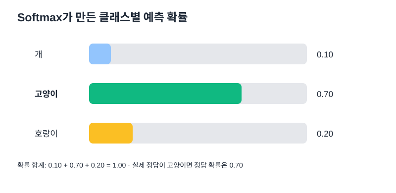
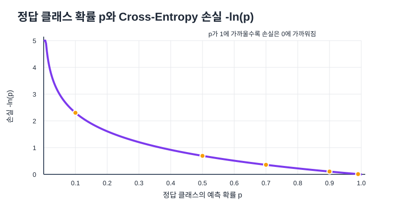

# 06. 다중 분류와 교차 엔트로피 손실

## 1. 여러 클래스 중 하나를 고르기

예를 들어 이미지를 개·고양이·호랑이 중 하나로 분류한다고 하자. 클래스가 3개이므로 출력층에는 보통 3개의 점수(logits)가 있다. Softmax는 이 점수를 합이 1인 확률 분포로 바꾼다.



| 클래스 | 예측 확률 | 정답 여부 |
|---|---:|---|
| 개 | 0.1 | 오답 클래스 |
| 고양이 | 0.7 | 정답 클래스 |
| 호랑이 | 0.2 | 오답 클래스 |
| 합계 | 1.0 | 확률 합은 1 |

모델은 고양이의 확률을 0.7로 가장 높게 예측했다. 실제 정답도 고양이라면 예측 클래스는 맞았지만, 확률이 1.0은 아니므로 손실은 0보다 크다.

## 2. Softmax: 점수를 확률로 바꾸기

출력 점수를 `z₁, z₂, …, zₖ`라고 하면 클래스 `i`의 Softmax 확률은 다음과 같다.

$$p_i=\frac{e^{z_i}}{\sum_{j=1}^{K}e^{z_j}}$$

- 각 확률은 0과 1 사이에 있다.
- 모든 클래스 확률의 합은 1이다.
- 점수가 상대적으로 큰 클래스일수록 확률이 높아진다.
- Softmax 확률은 모델의 예측 확률이지, 반드시 현실에서 완벽하게 보정된 확률이라는 뜻은 아니다.

## 3. One-Hot Encoding으로 정답 표시

클래스 순서를 `[개, 고양이, 호랑이]`로 고정하면 고양이의 정답 레이블은 다음과 같다.

```text
[0, 1, 0]
```

정답 클래스 위치만 1이고 나머지는 0이다. 클래스 순서가 바뀌면 레이블 벡터의 위치도 바뀌므로 순서를 일관되게 유지해야 한다.

## 4. Cross-Entropy 계산

다중 분류의 교차 엔트로피 손실은 다음과 같다.

$$L=-\sum_{k=1}^{K}t_k\log(p_k)$$

- `tₖ`: 클래스 k의 정답 값(One-Hot에서는 정답이면 1, 아니면 0)
- `pₖ`: 클래스 k에 대한 예측 확률
- `K`: 클래스 수

정답이 고양이고 예측 확률이 `[0.1, 0.7, 0.2]`이면

$$L=-[0\log(0.1)+1\log(0.7)+0\log(0.2)]$$

0이 곱해진 항은 손실에 기여하지 않으므로

$$L=-\log(0.7)\approx0.357$$

정답 클래스 확률이 높아질수록 손실이 작아진다. `p=1`이면 `-log(1)=0`이다.

## 5. 정답 확률과 손실 크기의 관계



| 정답 클래스 확률 `p` | `-ln(p)` 손실(약) | 해석 |
|---:|---:|---|
| 0.01 | 4.605 | 정답 확률이 매우 낮아 큰 손실 |
| 0.10 | 2.303 | 정답일 가능성을 낮게 평가 |
| 0.50 | 0.693 | 절반 정도의 확률 |
| 0.70 | 0.357 | 비교적 높은 확률 |
| 0.90 | 0.105 | 높은 확률, 손실 작음 |
| 0.99 | 0.010 | 매우 높은 확률, 손실이 0에 가까움 |

`-log(p)`는 `p`가 0에 가까울수록 급격히 커진다. 특히 정답 클래스의 확률을 아주 낮게 예측하는 것을 강하게 벌준다.

## 실전 구현: PyTorch에서 기억할 차이

개념식은 One-Hot 레이블로 설명하기 좋지만, PyTorch의 `nn.CrossEntropyLoss()`에는 일반적으로 **Softmax 이전의 raw logits**와 **정수 클래스 인덱스**를 전달한다.

```python
import torch
from torch import nn

logits = torch.tensor([[1.0, 2.0, 0.5]])  # batch 1, 클래스 3개
label = torch.tensor([1])                  # 두 번째 클래스가 정답

criterion = nn.CrossEntropyLoss()
loss = criterion(logits, label)
```

- `logits` 모양: `(batch_size, num_classes)`
- `label` 모양: `(batch_size,)`
- `label` 자료형: `torch.long`
- 모델 출력에 Softmax를 먼저 적용하지 않는다. `CrossEntropyLoss`가 필요한 계산을 내부에서 처리한다.

## 7. 이진 분류와 다중 분류

| 구분 | 이진 분류 | 다중 클래스 분류 |
|---|---|---|
| 가능한 정답 | 2개 | 보통 3개 이상 |
| 흔한 출력 | 1개 로짓 | 클래스마다 1개 로짓 |
| 일반적인 손실 | `BCEWithLogitsLoss` | `CrossEntropyLoss` |
| 정답 표현(PyTorch 일반 사용) | 0/1 실수 텐서 | 0, 1, 2, … 정수 인덱스 |

## 자기 점검

1. 클래스가 5개라면 출력층에 보통 몇 개의 로짓이 필요한가?
2. 정답이 `[0, 0, 1, 0, 0]`이라면 어떤 클래스가 정답인가?
3. 정답 확률이 0.7일 때 Cross-Entropy를 계산하라.
4. 정답 클래스의 예측 확률이 0.7에서 0.9로 올라가면 손실은 커지는가, 작아지는가?
5. PyTorch `CrossEntropyLoss`에 Softmax를 미리 적용하지 않는 이유는?
