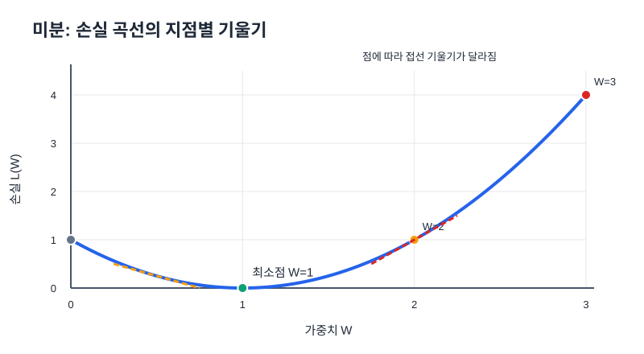

# 07. 미분과 기울기

## 1. 미분은 변화율을 알려준다

미분은 입력값을 아주 조금 바꿨을 때 함수값이 얼마나 변하는지 나타낸다. 그래프에서는 해당 지점에 그은 **접선의 기울기**로 이해할 수 있다.

- 양수 기울기: x가 증가할 때 함수값도 증가하는 방향
- 음수 기울기: x가 증가할 때 함수값은 감소하는 방향
- 기울기 0: 그 지점에서 접선이 수평. 최소점·최대점 또는 다른 정지점일 수 있다.

## 2. 손실 함수를 식으로 만들기

입력 `x=1`, 정답 `t=1`, 예측값 `ŷ=Wx`인 회귀 예제를 사용한다.

$$\hat y=Wx=W$$

$$L=(t-\hat y)^2=(1-W)^2$$

전개하면 `L(W) = W² - 2W + 1`이다. 위로 열린 포물선이며 `W=1`에서 손실이 0이 된다.

## 3. 미분 과정

$$L(W)=(1-W)^2$$

합성함수 미분(연쇄법칙)을 적용한다.

$$\frac{dL}{dW}=2(1-W)\times(-1)=2(W-1)$$

| W | 손실 `L=(1-W)²` | 기울기 `dL/dW=2(W-1)` | 의미 |
|---:|---:|---:|---|
| 0 | 1 | -2 | W를 늘리면 손실이 내려가는 구간 |
| 0.5 | 0.25 | -1 | 최소점 왼쪽 |
| 1 | 0 | 0 | 최소점 |
| 2 | 1 | 2 | W를 줄이면 손실이 내려가는 구간 |
| 3 | 4 | 4 | 더 가파른 오르막 |

기울기의 **부호는 방향**, 절댓값의 **크기는 국소적인 변화의 정도**를 알려준다. 기울기 크기가 크다고 손실 자체가 항상 크다는 뜻은 아니며, 기울기는 해당 위치에서의 변화율이다.

## 4. 미분과 경사하강법의 연결

$$W_{new}=W_{old}-\eta\frac{dL}{dW}$$

예를 들어 `W=3`, `η=0.1`이면

- 기울기: `2(3-1)=4`
- 업데이트: `W_new = 3 - 0.1 × 4 = 2.6`
- 손실: `4 → (1-2.6)² = 2.56`

기울기 계산이 이동 방향을 알려주고, 학습률이 이동 폭을 정한다. 이 둘을 결합한 것이 경사하강법이다.

## 한 단계 더: 해석적 미분과 수치 미분

### 해석적 미분

미분 공식으로 정확한 미분식을 구하는 방법이다. 위 예제에서 `dL/dW = 2(W-1)`이 해석적 미분 결과다.

### 수치 미분

아주 작은 변화량 `h`를 사용해 미분을 근사한다.

$$f'(x)\approx\frac{f(x+h)-f(x)}{h}$$

중심 차분은 양쪽 값을 사용한다.

$$f'(x)\approx\frac{f(x+h)-f(x-h)}{2h}$$

`h`가 너무 크면 기울기를 부정확하게 근사할 수 있고, 너무 작으면 컴퓨터의 부동소수점 오차가 영향을 줄 수 있다. 실제 딥러닝 학습은 보통 역전파로 미분을 계산하지만, 수치 미분은 기울기 계산이 올바른지 확인하는 데 사용할 수 있다.

## 한 단계 더: 변수 하나와 여러 개의 차이

- **미분:** 변수가 하나인 함수의 변화율을 다룬다.
- **편미분:** 여러 변수 중 한 변수에 대해서만 미분하고 나머지는 고정한다.
- **기울기 벡터(Gradient):** 여러 변수에 대한 편미분 값을 모은 벡터다.

예를 들어 `L(w₁,w₂)`라면

$$\nabla L=\left[\frac{\partial L}{\partial w_1},\frac{\partial L}{\partial w_2}\right]$$

신경망은 가중치가 많기 때문에 각 가중치에 대한 편미분을 계산하고 이를 이용해 매개변수를 업데이트한다.

## 자기 점검

1. `L(W)=(1-W)²`의 미분을 직접 계산하라.
2. `W=0.5`일 때 기울기의 부호는 무엇인가? W를 어느 방향으로 움직여야 손실이 줄어드는가?
3. `W=3`, 학습률 0.1일 때 한 번 업데이트한 W는 얼마인가?
4. 미분과 수치 미분은 어떤 점에서 다른가?
5. 편미분과 기울기 벡터가 필요한 이유를 설명하라.
