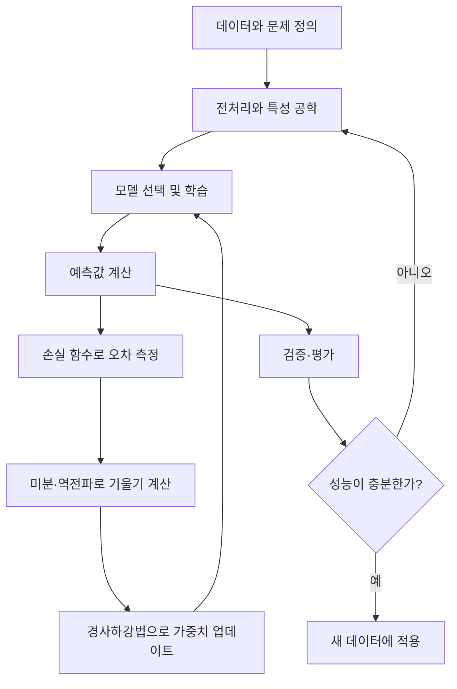

# AI / 머신러닝 개인 복습 노트

개념을 따로 외우기보다 **데이터 → 모델 → 예측 → 손실 → 기울기 → 업데이트 → 평가** 흐름으로 연결해 이해한다.

## 학습 지도

## 단원

| 단원 | 핵심 질문 | 복습 자료 |
|---|---|---|
| 01. 경사하강법 | 손실을 줄이도록 가중치를 어떻게 움직일까? | [경사하강법](01_경사하강법.md) |
| 02. 모델 검증 및 평가 | 예측 결과가 실제로 얼마나 좋은가? | [모델 검증 및 평가](02_모델검증_및_평가.md) |
| 03. 딥러닝 | 신경망은 예측하고 학습하는 과정을 어떻게 구성할까? | [딥러닝](03_딥러닝.md) |
| 04. 딥러닝 학습 흐름 | 순전파·손실·역전파·업데이트는 어떻게 연결될까? | [딥러닝 학습 요약](04_딥러닝_학습_요약.md) |
| 05. 머신러닝 | 문제에 맞는 데이터를 만들고 모델을 고르는 방법은? | [머신러닝](05_머신러닝.md) |
| 06. 다중 분류 손실 | 여러 클래스 중 정답을 맞히는 것을 어떻게 학습할까? | [다중 분류 손실](06_다중분류_손실.md) |
| 07. 미분 | 기울기는 손실 곡선에서 무엇을 알려줄까? | [미분](07_미분.md) |

## 핵심 개념을 연결하기

| 개념 | 기억할 한 문장 | 연결되는 개념 |
|---|---|---|
| 특성(feature) | 모델에 입력하는 설명 변수 | 전처리, 인코딩, 스케일링 |
| 가중치(weight) | 입력 신호의 영향력을 조절하는 학습 대상 | 퍼셉트론, 미분, 경사하강법 |
| 예측값(prediction) | 현재 가중치로 모델이 계산한 결과 | 손실 함수, 평가 지표 |
| 손실(loss) | 예측과 정답이 얼마나 다른지를 나타내는 값 | MSE, Cross-Entropy |
| 기울기(gradient) | 매개변수를 조금 바꿀 때 손실이 변하는 방향과 정도 | 미분, 역전파 |
| 평가 지표(metric) | 모델의 성능을 목적에 맞게 수치화한 기준 | Accuracy, Recall, F1, RMSE |

## 공부할 때 지킬 순서

1. 공식을 보기 전에 **각 기호가 무엇을 뜻하는지** 말로 설명한다.
2. 숫자를 직접 대입해 예측값과 손실을 계산한다.
3. 표와 그래프를 보고 값이 왜 커지거나 작아지는지 설명한다.
4. 마지막 자기 점검 문제를 풀고, 틀린 개념만 다시 확인한다.

> 목표는 공식을 외우는 데서 끝나지 않고, 새 문제를 만났을 때 어떤 모델·손실·평가 지표를 사용해야 할지 설명할 수 있는 것이다.
